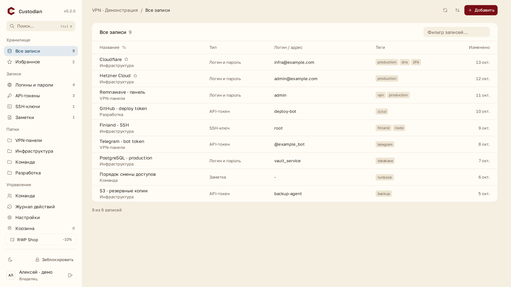
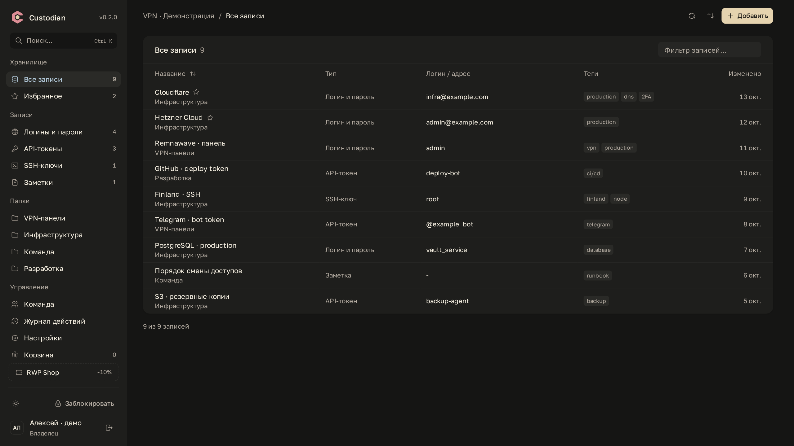
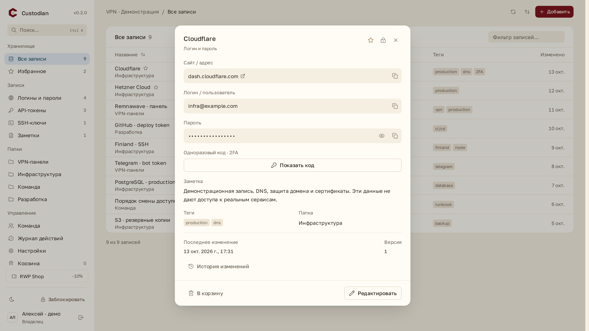
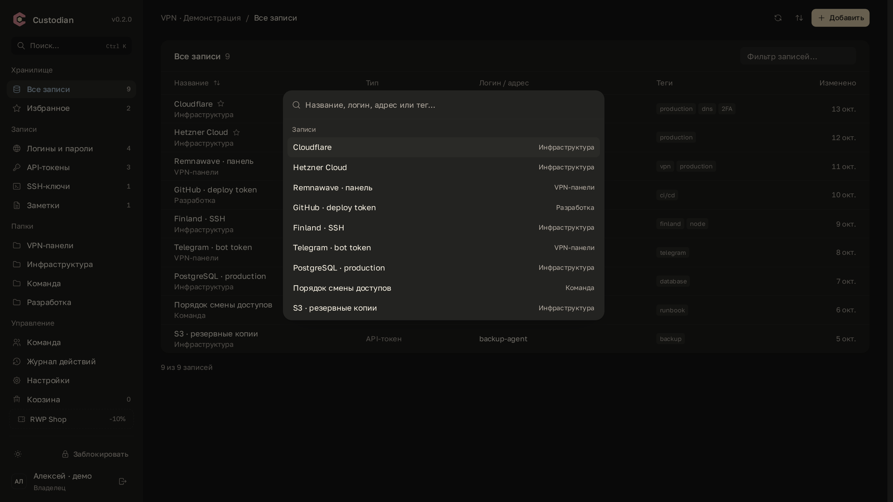

# Custodian


[](https://github.com/trillvertual/custodian/actions/workflows/ci.yml)
[](LICENSE)
[](https://github.com/trillvertual/custodian/releases/tag/v0.2.0)

Self-hosted менеджер общих доступов для команды VPN-сервиса. Одна установка, один владелец и приглашённые администраторы. Все активные участники видят и редактируют все записи.

TypeScript, React, компоненты на Radix, Fastify, PostgreSQL и Docker Compose. Frontend основан на [infra-billing](https://github.com/mishkatik/infra-billing). [Карта переноса](docs/FRONTEND-SOURCE.md).

## Интерфейс

<table>
  <tr>
    <td width="50%" valign="top">
      <strong>Светлая тема</strong><br>
      <sub>Общие доступы, папки и теги</sub><br><br>
      <a href="docs/screenshots/vault-light.png">
        
      </a>
    </td>
    <td width="50%" valign="top">
      <strong>Тёмная тема</strong><br>
      <sub>То же хранилище в тёмной палитре</sub><br><br>
      <a href="docs/screenshots/vault-dark.png">
        
      </a>
    </td>
  </tr>
  <tr>
    <td width="50%" valign="top">
      <strong>Карточка записи</strong><br>
      <sub>Логин, пароль, 2FA и заметка</sub><br><br>
      <a href="docs/screenshots/record-light.png">
        
      </a>
    </td>
    <td width="50%" valign="top">
      <strong>Быстрый поиск</strong><br>
      <sub>Доступ к записям через Ctrl+K</sub><br><br>
      <a href="docs/screenshots/search-dark.png">
        
      </a>
    </td>
  </tr>
</table>

Нажмите на скриншот, чтобы открыть оригинал **2560×1440**. Демонстрационные данные, секреты скрыты. [Повторить съёмку](docs/screenshots/README.md).

## Возможности

- Логины, пароли, API-токены, SSH-ключи, заметки и дополнительные секретные поля.
- Папки, теги, избранное, поиск, генератор паролей, корзина и история версий.
- TOTP: Base32 или `otpauth://`, SHA-1/SHA-256/SHA-512, 6/8 цифр, 30/60 секунд.
- Один пароль для входа и открытия записей, либо Passkey с WebAuthn PRF.
- Включение и отключение способов входа с защитой последнего рабочего способа.
- Закрытая регистрация и одноразовые приглашения на 24 часа.
- Выдача ключа участнику после проверки отпечатка, восстановление доступа админа владельцем.
- Смена ключа и перешифрование записей, корзины и истории при отключении участника.
- Ручная блокировка. Бездействие и переключение вкладок не закрывают хранилище; ключи остаются только в памяти страницы.
- Зашифрованная выгрузка и rescue CLI.

## RWP Shop

[](https://rwp.rw/)

[**RWP Shop**](https://rwp.rw/) - бот для VPN-коммерции на Remnawave: платежи, подписки, личный кабинет клиента и аналитика. Работает в браузере и как Mini App в Telegram.

**Скидка 10% по промокоду `LAZYBAGEL`.**

## Запуск на VPS

Готовый релиз с архивами, SHA-256 и Docker-образом: [v0.2.0](https://github.com/trillvertual/custodian/releases/tag/v0.2.0). [Установка, backup, обновление и откат](docs/OPERATIONS.md). [Changelog](CHANGELOG.md), [правила разработки](CONTRIBUTING.md), [сообщения об уязвимостях](SECURITY.md), [сторонние исходники и права](THIRD_PARTY_NOTICES.md).

Нужны Node.js >=22.12 для настройки, Docker Compose и HTTPS reverse proxy.

```bash
npm ci
npm run configure -- --url https://vault.example.com
docker compose up -d --build
```

Команда настройки создаёт `.env` с правами `0600`, случайными паролем базы и `SETUP_TOKEN`. Существующий файл не перезаписывается. Укажите свой домен. Секрет `SETUP_TOKEN` потребуется на странице первого запуска; после создания владельца регистрация по этому коду закрывается.

Приложение доступно только на `127.0.0.1:8080`; база не публикует порт. Пример для уже установленного Caddy:

```caddyfile
vault.example.com {
    encode zstd gzip
    reverse_proxy 127.0.0.1:8080
}
```

Откройте домен, создайте владельца, задайте пароль и сохраните rescue-ключ отдельно от сервера. Этот пароль одновременно открывает аккаунт и записи. В настройках можно подключить Passkey и отключить пароль, если Passkey поддерживает открытие записей.

`APP_URL` должен точно соответствовать публичному HTTPS origin без пути. В production приложение откажется запускаться с HTTP. Домен Passkey привязан к `APP_URL`; при смене домена потребуется повторная регистрация Passkey через другой метод входа.

## Вход и Passkey

На странице входа доступны логин/пароль и Passkey. После входа по паролю записи открываются сразу, повторный пароль не нужен. После ручной блокировки или перезагрузки страницы используется тот же пароль или Passkey.

В настройках можно изменить или отключить пароль, добавить либо отключить Passkey. Чтобы отключить пароль, нужен Passkey с сохранённой PRF-обёрткой личного ключа. Последний способ, способный открыть записи, нельзя отключить ни через интерфейс, ни через API. Passkey без PRF может подтвердить вход, но не заменяет пароль при открытии записей. Для уже добавленного такого Passkey есть кнопка «Настроить открытие».

Если PRF возвращается только при последующей аутентификации, приложение запрашивает её после регистрации и сохраняет зашифрованную обёртку. Значение PRF остаётся в браузере. Реальная поддержка зависит от браузера и выбранного хранилища Passkey.

Серверные OAuth endpoints оставлены для совместимости прежних установок; кнопок внешних провайдеров в текущем интерфейсе нет. Они не считаются заменой метода открытия записей при отключении пароля.

## Как устроено шифрование

Содержимое записей, включая названия, сайты, папки, теги, заметки и TOTP-секреты, шифруется в браузере через libsodium, XChaCha20-Poly1305 с уникальным случайным nonce и привязкой к хранилищу, записи, версии и эпохе ключа. Поиск и фильтрация происходят после разблокировки в браузере.

У каждого участника свой X25519 ключ. Общий случайный ключ хранилища передаётся в sealed box публичному ключу участника. Приватный ключ участника защищён паролем через Argon2id: 64 MiB, 3 прохода, случайная соль. Пароль и расшифрованный приватный ключ не отправляются серверу.

Совместимый Passkey с WebAuthn PRF может разблокировать приватный ключ без ввода пароля. PRF-результат никогда не отправляется серверу. Если устройство не вернуло PRF при регистрации, Passkey работает для входа, а разблокировка производится паролем. Можно добавить новый Passkey после разблокировки. [Описание PRF](https://developer.mozilla.org/en-US/docs/Web/API/Web_Authentication_API/WebAuthn_extensions#prf).

Для входа браузер вычисляет отдельный 32-байтовый verifier через Argon2id (64 MiB, 3 прохода) со стабильной публичной солью, привязанной к домену установки и нормализованному логину. Сервер хранит его scrypt-хеш. Verifier не открывает личный ключ: его обёртка использует другую, случайную соль. При изменении пароля verifier и обёртка обновляются в одной транзакции с проверкой исходной версии; остальные сессии пользователя отзываются. Изменение домена или логина требует пересоздания verifier; для владельца используйте rescue CLI. Старые парольные хеши не принимаются новым API до явной миграции. Сохранённое JSON-поле identity.master оставлено только для совместимости шифрованного формата. Сессии: случайные opaque токены, в базе только SHA-256 хеш, HttpOnly/Secure/SameSite cookie, проверка Origin и CSRF. Для управления входом, приглашений, восстановления, выгрузок и отключения участников требуется вход не старше 15 минут.

Доступ к серверу или копии базы сам по себе не расшифрует записи. Но владелец сервера способен изменить отдаваемый JavaScript, а заражённое устройство или расширение браузера может прочитать открытое хранилище. E2EE веб-приложения не устраняет эти риски. Сервер также видит участников, время изменений, количество и размеры записей. Подробнее: [модель безопасности](docs/SECURITY.md).

## Приглашение и восстановление админа

1. Владелец создаёт одноразовую ссылку в разделе «Команда» и передаёт её лично.
2. Админ создаёт аккаунт с единым паролем.
3. Владелец сверяет отпечаток ключа админа через доверенный канал и нажимает «Выдать доступ».
4. Если админ потерял пароль, он входит через подключённый метод и выбирает восстановление. Создаётся новый личный ключ; владелец снова сверяет отпечаток и выдаёт общий ключ. Остальные сессии админа отзываются.

После отключения участника его сессии аннулируются, общий ключ сменяется, актуальные записи и история перешифровываются. Сохранённые участником ранее секреты не исчезают: нужно сменить пароли, отозвать токены и SSH-ключи в соответствующих сервисах. Новый rescue-ключ скачивается до смены ключа; старые ключи сохраняйте для старых резервных копий.

## Rescue CLI

Ключ передаётся через файл, а не аргумент командной строки или переменную окружения. Файл rescue-ключа из браузера содержит код `SVR1.…` в первой строке. CLI игнорирует текст после первой строки. Без подходящего ключа восстановление невозможно.

### Зашифрованная выгрузка

На машине с доступом к БД и `DATABASE_URL`:

```bash
npm run rescue -- backup --output ./private/backup.json
```

Можно выполнить CLI в контейнере приложения, используя его конфигурацию базы:

```bash
docker compose exec -T app node packages/rescue/dist/index.js backup --output /tmp/backup.json
docker compose cp app:/tmp/backup.json ./private/backup.json
```

Это зашифрованная выгрузка актуальных записей и корзины для офлайн-расшифровки. Она не заменяет полный PostgreSQL backup с участниками, историей и журналом. Для полного восстановления сервера дополнительно делайте `pg_dump` и сохраняйте конфигурацию.

### Локальная расшифровка

```bash
npm run rescue -- decrypt \
  --backup ./private/backup.json \
  --key-file ./private/custodian-rescue-epoch-1.txt \
  --output ./private/credentials.json \
  --allow-plaintext
```

База и работающий сервер не нужны. Выходной файл содержит пароли в открытом виде. CLI создаёт его с правами `0600`, каталог с `0700` и не перезаписывает существующий файл. Не отправляйте его в чат и удалите после использования. Rescue-ключ должен соответствовать эпохе резервной копии.

### Восстановление владельца

Подготовьте файл `password.txt` с новым паролем от 14 до 256 символов, с правами `0600`. Приостановите работу пользователей на время восстановления.

```bash
npm run rescue -- recover-owner \
  --key-file ./private/custodian-rescue-epoch-1.txt \
  --password-file ./private/password.txt
```

Команда использует `DATABASE_URL`. Она проверяет rescue-ключ текущей эпохи, меняет личный ключ владельца, включает вход с новым паролем и отзывает его сессии, прежние Passkey и связи Telegram/GitHub. Записи и доступы остальных админов сохраняются. Войдите с новым паролем и заново подключите Passkey.

Для запуска в контейнере сначала скопируйте файлы в `/tmp` контейнера и используйте `node packages/rescue/dist/index.js recover-owner ...`. Удалите файлы паролей после успешной настройки.

## Разработка и проверки

```bash
npm ci
npm run typecheck
npm test
npm run build
npm run format:check
npm run secrets:check
```

Браузерные проверки desktop/mobile выполняются на собранном frontend и изолированном API с синтетической базой:

```bash
npx playwright install --with-deps chromium
npm run test:browser
```

Установка системных библиотек требует прав администратора; если они уже есть, достаточно `npx playwright install chromium --only-shell`. [Документация Playwright](https://playwright.dev/docs/browsers). Тесты поднимают отдельные API для desktop/mobile на `127.0.0.1:3010` и `127.0.0.1:3011`, завершают их после проверки и сохраняют снимки в `.impeccable/review/`. Проверяются темы, навигация клавиатурой, формы, шифрование, история, корзина, копирование, ручная блокировка, reduced motion и доступность через axe-core. [Результаты проверок](docs/VALIDATION.md), [аудит интерфейса](docs/UI-AUDIT.md).

Для разработки с обычным PostgreSQL создайте `.env` с `NODE_ENV=development`, `APP_URL=http://localhost:5173`, `DATABASE_URL` с адресом вашей базы и случайным `SETUP_TOKEN`, затем `npm run dev`.

Изолированный демосервер с синтетическими записями и PostgreSQL-движком PGlite:

```bash
npm run preview:demo
```

Откройте `http://localhost:5173`. Логин: `demo`, пароль: `Demo login password 2026!`. Демосервер не подключается к production-базе, существует только в `tests/` и не входит в Docker-образ. Все данные явно демонстрационные и исчезают при остановке.

Тесты проверяют привязку шифртекста и PRF, восстановление, RFC 6238 для всех трёх алгоритмов, закрытые приглашения, роли, CSRF/Origin, optimistic concurrency, историю и ротацию ключа. SQL выполняется embedded PostgreSQL, а не на словарном mock. Advisory locks в тестовом адаптере заменены сериализацией соединений; проверка многопроцессных гонок требует настоящего PostgreSQL.

Реальные входы Telegram/GitHub требуют ваших Client ID/Secret; внешний smoke test выполняется после их настройки. Passkey требует реального совместимого устройства и HTTPS. Автоматические проверки не заменяют независимый аудит менеджера паролей перед хранением критичных production-секретов.

## Лицензия

Авторский код Custodian распространяется под [MIT](LICENSE). Сторонние компоненты сохраняют свои права и лицензии: [THIRD_PARTY_NOTICES.md](THIRD_PARTY_NOTICES.md).
